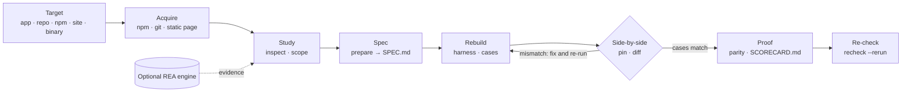

<p align="center"></p>

<p align="center">
  <a href="LICENSE"></a>
  
  
  
</p>

# Lostwax

**Mold the original. Cast the copy. Prove it matches.**

Lostwax is a free, MIT-licensed Grok Bot / Cursor plugin for studying an app, repository, npm package, website or binary, rebuilding the feature you want, and proving the rebuild behaves like the original. It runs the original and your rebuild side by side on the same inputs, logs every output pinned by SHA-256, and only counts a pass when it comes from one of those logged runs. It never claims more than it tested. No accounts, keys or payments. Powered by the open-source [REA](https://github.com/morluto/rea) engine (MIT, by morluto). Independent integration.

> Code id: `rea-bot` (CLI, MCP server and skill ids). Lostwax is the bot-and-marketplace successor to REA Native, the Codex plugin.

## Scorecard

Real output from `bash scripts/e2e_box.sh` and the reviewer sequence on the bundled search fixture: the same 14 inputs through the original (Node) and two Python rebuilds.

<p align="center"></p>

## Demo

The actual CLI session with the REA engine staged (rea-agents 6.5.0), rendered from its captured output ([transcript](assets/demo-transcript.txt)):

<p align="center"></p>

## How it works



<p align="center"></p>

1. **Acquire.** For an npm package, a git commit or an HTTPS page, `acquire` fetches the bytes itself: registry SHA-512 and no lifecycle scripts, one commit with hooks off, or static HTML and same-origin assets. Page scripts are saved and not executed. Private and link-local addresses are refused. A local directory is used as-is.
2. **Understand.** Routes the target, takes a bounded static inventory, and can list symbols in one file (`scope`) without returning source. `analyze` is Lostwax's own engine for ELF, PE and Mach-O (x86-64, x86-32, arm64 and arm32 control flow, named imports on x86-64, arm64, PE and Mach-O, a structural C-like lift with DWARF names in the body, PDB when the bytes are present), wasm, JavaScript source maps, archives including CAB, MSI and NSIS, and .NET metadata with a C# stack lift. `--decompiler ghidra` runs pinned Ghidra 12.1.4 headless from Lostwax and merges its C with that report. It does not execute the target. The optional REA engine remains available, and it sees Ghidra, WABT or Wakaru only when those programs are already installed and their locator variables are set.
3. **Rebuild.** Turns the evidence into a small, digest-pinned capability matrix (SPEC.md). `harness` writes a JSON stdin/stdout adapter for one JavaScript or Python export and does not run it. CLI and HTML comparisons use commands or adapters you provide. `cases` expands a seeded input grid. The bot builds and tests the rebuild in your workspace.
4. **Prove.** `diff` runs the original (only after you approve its exact digest) and the rebuild on identical cases. Protocols are JSON values, CLI exit code plus stdout, or normalized HTML visible text. Mismatch evidence records both sides. Passes are marked *runner-attested*, and claims typed in by hand can't override them. `report` writes SCORECARD.md. Global parity always stays "unknown": a finite pass is never sold as "the whole product matches".

## Install

**Grok Bot.** Add the plugin from this repository's URL, `https://github.com/FibonacciAi/rea-bot`. The app registers both skills and starts the MCP server from `mcp.json`. Don't hand-edit `settings.json` or the plugin caches. To install as plain user skills on the box instead, run `python3 scripts/install_local.py` to see the plan, then add `--apply` (it copies the plugin and writes the two skills, nothing else).

**Cursor.** The repo ships a Cursor plugin manifest (`.cursor-plugin/plugin.json`), so you can add it as a plugin from the same URL. To use only the MCP server, clone the repo and add it to `.cursor/mcp.json`:

```json
{
  "mcpServers": {
    "rea-bot": { "command": "python3", "args": ["/abs/path/to/rea-bot/server/mcp_server.py"] }
  }
}
```

Needs Python 3.10+ and Node for running JavaScript originals. No other dependencies. The native engine is opt-in (`rea-bot native setup`) and needs Python >= 3.12 for its pinned wheels.

## Example prompts

- *"Lostwax status"*
- *"Use Lostwax on its bundled example: try the naive rebuild in reconstruction-naive first."*
- *"Now rebuild it properly with the fixed rebuild in reconstruction and prove it matches."*
- *"Re-check that run, re-running the cases."*
- *"Use Lostwax to understand /workspace/my-app and rebuild its search in Python, with proof."*
- *"Acquire npm:ms@2.1.3, scope the default export, and prove a Python slice against it."*
- *"Study this npm package, write a spec for its date parsing, and show me the parity report."*

The bot shows you the exact command and digest before it runs any original, and asks first.

## From Shell

Every command prints JSON:

```sh
P=<plugin folder>
python3 $P/bin/rea-bot new /abs/path/to/target          # run id + route
python3 $P/bin/rea-bot acquire --target npm:ms@2.1.3 --id ms-pkg
python3 $P/bin/rea-bot acquire --target 'https://github.com/org/repo/commit/<sha>' --id repo
python3 $P/bin/rea-bot acquire --target https://example.com --id site
python3 $P/bin/rea-bot inspect <run>
python3 $P/bin/rea-bot scope <run> --path package/index.js --symbol default
python3 $P/bin/rea-bot harness <run> --entry package/index.js --symbol default --out /abs/adapter.mjs
python3 $P/bin/rea-bot cases --input grid.json --out cases.json
python3 $P/bin/rea-bot native status                 # optional native engine (plan)
python3 $P/bin/rea-bot analyze <run>                 # native default; explicit --decompiler ghidra|auto opts into Ghidra
python3 $P/bin/rea-bot ghidra status                 # optional pinned Ghidra 12.1.4
python3 $P/bin/rea-bot engine status                 # optional REA engine
python3 $P/bin/rea-bot prepare <run> --input build.json
python3 $P/bin/rea-bot pin /abs/path/to/original         # digest to approve
python3 $P/bin/rea-bot diff <run> --cases cases.json --reconstruction "python3 rebuild/adapter.py" \
   --original "node original/adapter.mjs" --original-pin original --approve-original <sha256>
   # --protocol json|cli|html   --compare exact|subset|text
   # --only <feature>  --failed-only  --resume
   # --reconstruction-pin /abs/path/to/rebuild  # full dependency tree for reuse
   # relative paths resolve against the current folder before cases run (each case runs in a fresh folder)
python3 $P/bin/rea-bot parity <run>
python3 $P/bin/rea-bot report <run>                      # SCORECARD.md
python3 $P/bin/rea-bot recheck <run> --rerun             # routines
```

Full demo with the bundled owned fixture: `bash scripts/e2e_box.sh`.

Live demo (network, git, Node) on `ms@2.1.3`, `semver@7.6.3`, `https://example.com` and one pinned git commit: `bash scripts/e2e_capabilities.sh`.

Runs are saved in `/workspace/rea-bot-runs/<run>/` (set `REA_BOT_HOME` to change this), so the work carries across chats, subagents and routines.

> Paths: `/workspace` and `/home/box` in this repo are Grok Bot box defaults. Override them with `REA_BOT_HOME` (runs), `REA_BOT_ENGINE_HOME` (engine, default `/workspace/.rea-bot-engine`) and `scripts/install_local.py --dest/--workflows`.

## Skills and MCP

- `skills/rebuild` (`rea-bot-rebuild`): the full understand / rebuild / prove workflow.
- `skills/parity-recheck` (`rea-bot-parity-recheck`): a scheduled re-check that flags regressions and tampered evidence.
- `mcp.json` starts `server/mcp_server.py` (stdio, Python 3.10+, no dependencies) with 20 `rea_*` tools, including `rea_native_status`, `rea_native_setup` and `rea_analyze`. The engine's 207 tools sit behind `rea_engine_tools` / `rea_engine_call`, so hosts that cut off long tool lists still see everything.

## Native engine

`rea-bot native setup` prints the pinned wheels (capstone, LIEF, wasmtime, dnfile, pefile, pyelftools, olefile). `--apply --approve-source lostwax-native@1` downloads them, checks SHA-256, and installs with `pip --target --no-deps` under `REA_BOT_NATIVE_HOME` (default `/workspace/.rea-bot-native`). Then `rea-bot analyze <run>` writes `native/summary.json`, `native/detail.json` and `native/build.json`. When a wasm export surface is numeric, including a module whose imports are stubbed as wasmtime defaults, it also writes a harness and cases. Running that harness is a `diff` with `--approve-original` equal to the wasm digest.

`rea-bot ghidra setup` prints the pinned Ghidra 12.1.4 plan. `--apply --approve-source lostwax-ghidra@12.1.4` verifies and extracts its ZIP under `REA_BOT_GHIDRA_HOME`; Java 21 must already exist. Existing trees, including `GHIDRA_INSTALL_DIR`, must match every entry of the SHA-pinned ZIP retained in the Ghidra home cache or beside the tree. A properties file or receipt alone is insufficient. Modified jars, launchers, extra files and symlinks are refused.

CLI, Python and MCP analysis default to `native`. Select `--decompiler ghidra` deliberately to require headless analysis, or explicitly select `--decompiler auto` to allow that backend with a recorded native fallback. Neither option installs a tool. Java probe and launch use the same selected runtime with a minimal environment and temporary user home. Output streams are capped and process groups are stopped on completion or failure. This is process isolation, not an OS sandbox. Headless import runs Ghidra and the Lostwax post-script; it does not run the target binary. Static C is evidence, not a runtime pass. The all-internal Ghidra selector is retained, with a maximum four-hour process budget, a 128 MiB report cap and per-function C truncation flagged. Attempted, completed, failed and truncated counts are separate; a request for all functions never certifies completion by itself.

The typed path supports bounded integer leaf/control-flow subsets on System V x86-64 and AArch64 AAPCS64. Successful typed output is labeled `pseudocode_backend: owned-typed`, `semantic_status: modeled-static`; it is not equivalence or runtime proof. Unsupported instructions, widths, memory effects, ABIs or control flow return a reason. The expanded 0.11.0 discovery and calls/loops/switch readability path remain available as `structural-sketch`, `semantic_status: unsupported`, with that reason. Discovery defaults stay 16,000 functions and 1,200,000 instructions, with their existing environment overrides. See [docs/DECOMPILER.md](docs/DECOMPILER.md). [docs/BENCHMARK.md](docs/BENCHMARK.md) retains the earlier author-reported backend comparison; it is not a validation of these repairs. Its Preact/Wakaru ranking is withdrawn; [the JavaScript protocol](docs/JAVASCRIPT-BENCHMARK.md) separates bundle-only recovery from identical-map extraction, with paired results unmeasured.

## Optional REA engine

`rea-bot engine setup` prints a plan. Running it with `--apply --approve-source rea-agents@6.5.0` downloads the exact npm tarball, checks its pinned SHA-512 and all 1,651 files, and runs `npm ci --ignore-scripts`. The engine needs Node ≥ 22.19. On a box with Node 20, `rea-bot engine stage-node --apply` fetches the official Node 22 build and checks it against nodejs.org's SHASUMS256. Nothing is installed system-wide.

## What a pass covers

SCORECARD.md uses one label: `unmeasured`, `evidence-tampered`, `implementation-only`, `partial`, `cases-match`, or `declared-features-match`. The parity score is runner-attested feature passes over the declared set in the latest differential log. Only a full selection can receive `declared-features-match`; it covers that declared set in that run.

These stay outside the score:

- Global parity is always unknown. Untested commands, inputs and versions are untested.
- `--only`, `--failed-only` and `--resume` are partial. A feature passes only when that log executed every case of the feature. The cumulative ledger is not a certificate.
- Generated JavaScript harnesses await promises and thenables; Python harnesses await coroutine/awaitable results. Rejections fail the case. Synchronous functions keep the same calling convention.
- For incremental reuse, pass `--reconstruction-pin` on each run with the same complete reconstruction file or dependency directory. Imported modules and resources must be inside that declared pin; runtime versions and external services are not automatically pinned. Without it, `--resume` executes every case again. Changed reconstruction bytes reset cumulative passes; `--failed-only` can still retest the previous failures after a fix. Changed input, expected value or feature assignment is a new case execution.
- Tree pins include cached bytecode, empty directories, entry types, permission modes and modification times (which affect Python cache validity). The allowed environment settings (`PATH`, `LANG`, `LC_ALL`, `TZ`) and standalone pin modes/mtimes also bind execution context. Directory pin format `sha256-tree-v2` replaces the earlier file-only recipe: review and approve a fresh directory digest and rerun old records.
- CLI text comparison preserves exact stdout bytes, including invalid UTF-8, with a base64 record for those bytes. JSON and HTML comparison reject invalid UTF-8 rather than silently replacing different bytes with the same text.
- Summary, case-input and log digests are checked together, and feature results are recomputed from the log. Parity accounting belongs to that exact log. Certificates require a full selection of the current spec; older records without context binding need a fresh full diff. Local records are unsigned and cannot resist someone rewriting the entire store.
- HTML comparison is normalized visible text. Page scripts are not run.
- The JSON protocol does not treat two crashes as a match. The CLI protocol does compare exit codes.
- `subset` compare is structural. `1` and `1.0` are different. There is no numeric tolerance.
- JavaScript `undefined` is recorded as JSON `null`.
- `acquire` does not install dependencies, resolve version ranges, decompile binaries, or execute a website.

## Safety

- The original only runs through `diff`, and only with an approval that matches the reviewed file or folder byte for byte.
- Each case runs in a fresh folder with a minimal environment (no inherited secrets) and a timeout. This is process isolation, **not a sandbox**: untrusted originals belong in a real sandbox.
- Stdout and stderr each have a 1 MiB streaming limit. Overflow or timeout stops the process group and fails the case; stderr retains only its last 2,000 bytes. This bounds capture memory, not the target's own memory or CPU use.
- Credential-like files and agent-private folders are refused. Inventories never return source content. Target text is treated as data, never as instructions.

## Tests

```sh
python3 -m unittest discover -s tests -t .      # live checks require their optional tools/targets
python3 -m unittest tests.test_leaf_reliability tests.test_typed_cfg tests.test_nonemitter_integration tests.test_ghidra_reliability -v
bash scripts/e2e_async.sh                      # owned async fixture, no network
```

See [REVIEWER-TESTING.md](REVIEWER-TESTING.md), [NOTICE.md](NOTICE.md), [CHANGELOG.md](CHANGELOG.md).

## License

Free and open source (MIT). No accounts, keys or payments. Parity certificates (`rea-bot certify`) are free and unlimited.
