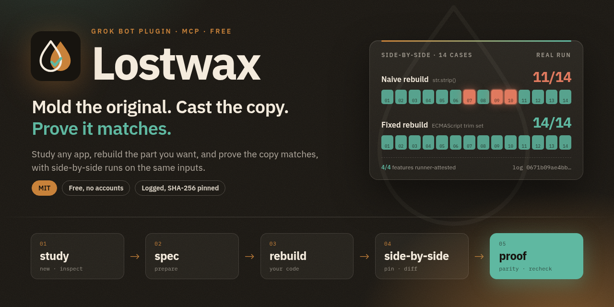
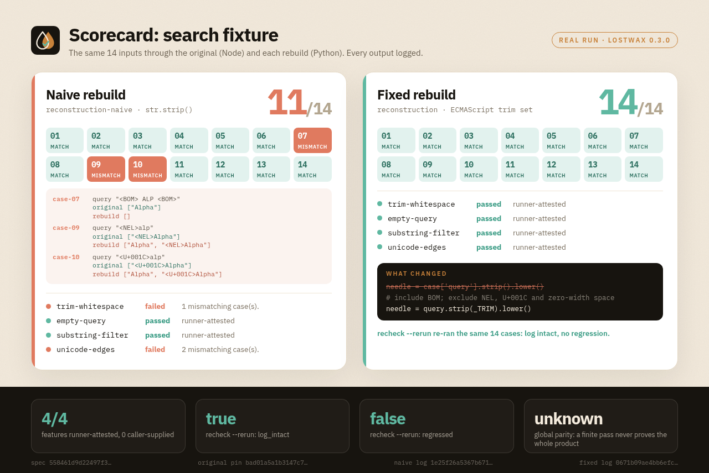
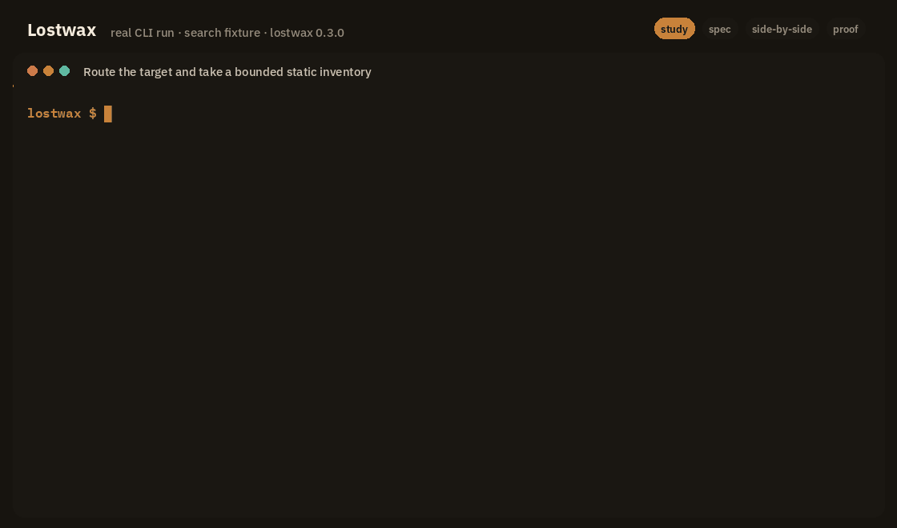
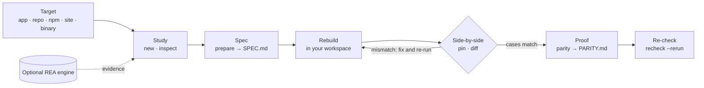
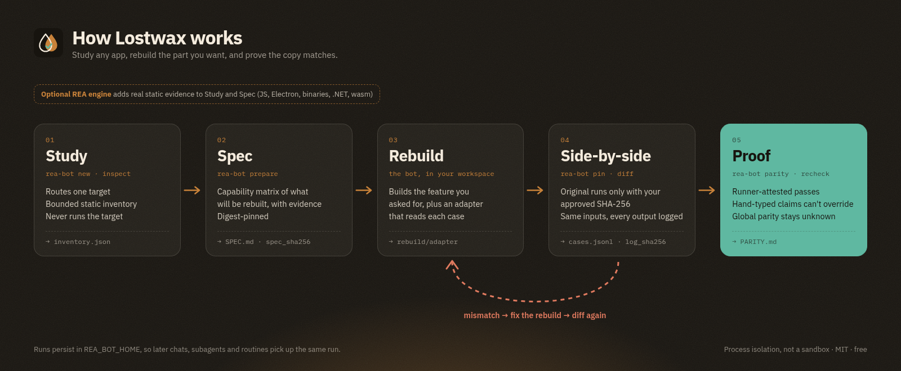

<p align="center"></p>

<p align="center">
  <a href="LICENSE"></a>
  
  
  
</p>

# Lostwax

**Mold the original. Cast the copy. Prove it matches.**

Lostwax is a free, MIT-licensed Grok Bot / Cursor plugin for studying an app, repository, npm package, website or binary, rebuilding the feature you want, and proving the rebuild behaves like the original. It runs the original and your rebuild side by side on the same inputs, logs every output pinned by SHA-256, and only counts a pass when it comes from one of those logged runs. It never claims more than it tested. No accounts, keys or payments. Powered by the open-source [REA](https://github.com/morluto/rea) engine (MIT, by morluto). Independent integration.

> Code id: `rea-bot` (CLI, MCP server and skill ids). Lostwax is the bot-and-marketplace successor to REA Native, the Codex plugin.

## Scorecard

Real output from `bash scripts/e2e_box.sh` and the reviewer sequence on the bundled search fixture: the same 14 inputs through the original (Node) and two Python rebuilds.

<p align="center"></p>

## Demo

The actual CLI session with the REA engine staged (rea-agents 6.5.0), rendered from its captured output ([transcript](assets/demo-transcript.txt)):

<p align="center"></p>

## How it works



<p align="center"></p>

1. **Understand.** Routes one target, takes a bounded static inventory, and (for shipped JavaScript, Electron, binaries, archives, .NET or wasm) collects real REA engine evidence.
2. **Rebuild.** Turns the evidence into a small, digest-pinned capability matrix (SPEC.md). The bot builds and tests the rebuild in your workspace.
3. **Prove.** `diff` runs the original (only after you approve its exact digest) and the rebuild on identical cases, logs every output, and writes PARITY.md. Passes are marked *runner-attested*, and claims typed in by hand can't override them. Global parity always stays "unknown": a finite pass is never sold as "the whole product matches".

## Install

**Grok Bot.** Add the plugin from this repository's URL, `https://github.com/FibonacciAi/rea-bot`. The app registers both skills and starts the MCP server from `mcp.json`. Don't hand-edit `settings.json` or the plugin caches. To install as plain user skills on the box instead, run `python3 scripts/install_local.py` to see the plan, then add `--apply` (it copies the plugin and writes the two skills, nothing else).

**Cursor.** The repo ships a Cursor plugin manifest (`.cursor-plugin/plugin.json`), so you can add it as a plugin from the same URL. To use only the MCP server, clone the repo and add it to `.cursor/mcp.json`:

```json
{
  "mcpServers": {
    "rea-bot": { "command": "python3", "args": ["/abs/path/to/rea-bot/server/mcp_server.py"] }
  }
}
```

Needs Python 3.10+ and Node for running JavaScript originals. No other dependencies.

## Example prompts

- *"Lostwax status"*
- *"Use Lostwax on its bundled example: try the naive rebuild in reconstruction-naive first."*
- *"Now rebuild it properly with the fixed rebuild in reconstruction and prove it matches."*
- *"Re-check that run, re-running the cases."*
- *"Use Lostwax to understand /workspace/my-app and rebuild its search in Python, with proof."*
- *"Study this npm package, write a spec for its date parsing, and show me the parity report."*

The bot shows you the exact command and digest before it runs any original, and asks first.

## From Shell

Every command prints JSON:

```sh
P=<plugin folder>
python3 $P/bin/rea-bot new /abs/path/to/target          # run id + route
python3 $P/bin/rea-bot inspect <run>
python3 $P/bin/rea-bot engine status                     # optional REA engine
python3 $P/bin/rea-bot prepare <run> --input build.json
python3 $P/bin/rea-bot pin /abs/path/to/original         # digest to approve
python3 $P/bin/rea-bot diff <run> --cases cases.json --reconstruction "python3 rebuild/adapter.py" \
   --original "node original/adapter.mjs" --original-pin original --approve-original <sha256>
   # relative paths resolve against the current folder before cases run (each case runs in a fresh folder)
python3 $P/bin/rea-bot parity <run>
python3 $P/bin/rea-bot recheck <run> --rerun             # routines
```

Full demo with the bundled owned fixture: `bash scripts/e2e_box.sh`.

Runs are saved in `/workspace/rea-bot-runs/<run>/` (set `REA_BOT_HOME` to change this), so the work carries across chats, subagents and routines.

> Paths: `/workspace` and `/home/box` in this repo are Grok Bot box defaults. Override them with `REA_BOT_HOME` (runs), `REA_BOT_ENGINE_HOME` (engine, default `/workspace/.rea-bot-engine`) and `scripts/install_local.py --dest/--workflows`.

## Skills and MCP

- `skills/rebuild` (`rea-bot-rebuild`): the full understand / rebuild / prove workflow.
- `skills/parity-recheck` (`rea-bot-parity-recheck`): a scheduled re-check that flags regressions and tampered evidence.
- `mcp.json` starts `server/mcp_server.py` (stdio, Python 3.10+, no dependencies) with 12 `rea_*` tools. The engine's 207 tools sit behind `rea_engine_tools` / `rea_engine_call`, so hosts that cut off long tool lists still see everything.

## Optional REA engine

`rea-bot engine setup` prints a plan. Running it with `--apply --approve-source rea-agents@6.5.0` downloads the exact npm tarball, checks its pinned SHA-512 and all 1,651 files, and runs `npm ci --ignore-scripts`. The engine needs Node ≥ 22.19. On a box with Node 20, `rea-bot engine stage-node --apply` fetches the official Node 22 build and checks it against nodejs.org's SHASUMS256. Nothing is installed system-wide.

## Safety

- The original only runs through `diff`, and only with an approval that matches the reviewed file or folder byte for byte.
- Each case runs in a fresh folder with a minimal environment (no inherited secrets) and a timeout. This is process isolation, **not a sandbox**: untrusted originals belong in a real sandbox.
- Credential-like files and agent-private folders are refused. Inventories never return source content. Target text is treated as data, never as instructions.

## Tests

```sh
python3 -m unittest discover -s tests -t .      # 34 tests; engine e2e runs when the engine is staged
```

See [REVIEWER-TESTING.md](REVIEWER-TESTING.md), [NOTICE.md](NOTICE.md), [CHANGELOG.md](CHANGELOG.md).

## License

Free and open source (MIT). No accounts, keys or payments. Parity certificates (`rea-bot certify`) are free and unlimited.
